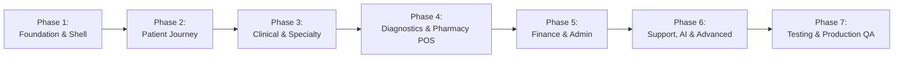

# MEDILINK HMIS — DESKTOP IMPLEMENTATION PLAN
**Target Application:** `Medilink-Desktop`  
**Reference Application:** `Medilink-Frontend` (Read-Only)  
**Backend Authority:** `Medilink-Backend`  
**Date:** November 8, 2026  
**Status:** Approved Roadmap  

---

## 1. Guiding Principles & Execution Rules

1. **Strict Read-Only Reference:** `Medilink-Frontend` must remain completely unmodified. All code changes are strictly confined to `Medilink-Desktop`.
2. **Authority Backend Contracts:** Endpoints, request schemas, and responses must adhere strictly to `Medilink-Backend` controllers and Prisma schemas. No invented or mock endpoints.
3. **Preserve Native Capabilities:** Tauri v2 runtime, Rust anti-tamper security flags, signed auto-updaters, local hardware printing, and device ID bindings must remain fully operational.
4. **Modular Architecture:** Build clean, modular components inside `Medilink-Desktop/src/components/` and `src/views/` rather than expanding the existing monolithic `App.tsx` and `WorkflowModuleView.tsx`.
5. **No Visual or Functional Placeholders:** Buttons, form fields, and table actions must be functionally wired to real backend endpoints.

---

## 2. Implementation Phases

---

### Phase 1: Foundation, Shell & Design System Synchronization
**Goal:** Align the desktop application shell, theme system, navigation architecture, and shared interaction layers with `Medilink-Frontend`.

1. **Design System & Styling:**
   * Import complete theme color variables, CSS tokens, and font presets into `Medilink-Desktop/src/App.css`.
   * Port the 35+ module stylesheet classes (`.biomed-page`, `.icu-page`, `.nicu-page`, `.rcm-page`, `.opd-page`, `.doctor-page`, `.exec-page`, etc.) from `Medilink-Frontend/src/app/globals.css`.
   * Establish unified display density (`data-density="compact" | "comfortable"`) and theme preferences (`data-theme="light" | "dark"`).
2. **Modular Application Shell:**
   * Implement `DesktopAppShell` mirroring `Medilink-Frontend/src/components/layout/AppShell.tsx`.
   * Implement `OrderInbox`: Real-time cross-department clinical order tray (Prescriptions, Lab, Radiology, Admissions).
   * Implement `TableInteractionLayer`: Standardized keyboard navigation, high-density row selection, and export actions.
   * Implement `FieldDescriptionLayer`: Contextual clinical guidance tooltips on form field focus.
   * Standardize `RecordDrawer`: Reusable right-side sliding drawer for viewing and editing records.
3. **Navigation & Topbar Synchronization:**
   * Upgrade `Sidebar` to match `Medilink-Frontend`:
     * Group modules into the 5 standard layers: **Patient Journey**, **Clinical**, **Administration**, **Hospital Support**, and **Advanced & Systems**.
     * Add real-time module search filter and collapsible state.
     * Include notification badges and active state indicators.
   * Synchronize `Topbar`: Include live clock, active facility branding, global search, order tray trigger, notification center, and user profile popover.
4. **API Client & Networking Hardening:**
   * Update `Medilink-Desktop/src/lib/apiClient.ts` to support token auto-refresh queue, CSRF header synchronizer, and standardized error responses matching `Medilink-Frontend/src/lib/api.ts`.

---

### Phase 2: Core Patient Journey Modules
**Goal:** Deliver full visual and functional parity for the primary patient intake and ambulatory care workflow.

1. **Patient Registration & Master Patient Index (`/patients`, ID 1):**
   * Synchronize `PatientsView` with `Medilink-Frontend/src/app/patients/page.tsx`:
     * Demographics, next of kin, SHA/NHIF/Private insurance verification.
     * Comprehensive `PatientDrawer` with multi-tab clinical timeline, visits, bills, and uploaded documents.
     * Master Patient Index (MPI) duplicate detection and auditable merge flow.
     * Break-glass emergency access integration.
2. **Appointments & Scheduling (`/appointments`, ID 4):**
   * Align slot-based calendar scheduling, provider availability, reminder triggers, and telemedicine join links.
3. **Queue Management (`/queue`, ID 28):**
   * Synchronize counter sessions, dynamic queue tokens, priority overrides, and cross-department transfers.
4. **Outpatient Department (OPD) Consultation & Triage (`/opd`, ID 36):**
   * Separate OPD into a dedicated clinical workspace (moving away from generic `OPDOTView`):
     * Vital signs triage with early warning scoring.
     * Structured clinical consultation notes (Chief complaint, History, Examination, Assessment, Plan).
     * ICD-10 diagnostic search and auto-suggest.
     * Inline ordering for Pharmacy prescriptions, Laboratory investigations, and Radiology exams.
5. **Inpatient Department (IPD) & Bed Allocation (`/ipd`, `/wards`, IDs 2 & 5):**
   * Implement dedicated Inpatient dashboard: Bed board visual grid, admission tracking, ward transfers, care plans, and discharge summaries.
6. **Emergency & Ambulance Unit (`/emergency`, `/ambulance`, IDs 25 & 26):**
   * Emergency triage acuity scoring (ESI / Manchester triage).
   * Ambulance fleet status, GPS dispatch logging, fuel tracking, and billing integration.

---

### Phase 3: Clinical Care & Specialty Departments
**Goal:** Replace generic workflow fallbacks with specialized, domain-tailored clinical dashboards.

1. **Electronic Health Records (`/ehr`, `/ehr/[patientId]`, ID 6):**
   * Longitudinal medical record timeline, SOAP notes, allergy warnings, past encounters, and document attachments.
2. **Clinical Decision Support System (`/cdss`, ID 48):**
   * Active rule engine dashboard, drug-drug interaction warnings, sepsis alerts, and clinical override logs.
3. **Nursing Administration & Care (`/nursing`, `/nursing-admin`, IDs 7 & 42):**
   * Nursing Kardex, Medication Administration Record (eMAR) with 5-Rights verification, nurse-to-patient staffing ratios.
4. **Maternity & Obstetrics (`/maternity`, ID 37):**
   * Antenatal Care (ANC) visit tracker, Partograph / Labor & Delivery records, newborn APGAR scoring, postnatal care.
5. **Intensive Care Unit (ICU) & Neonatal ICU (NICU) (`/icu`, `/nicu`, IDs 38 & 51):**
   * ICU: Real-time vitals monitoring, ventilator settings, arterial line tracking, APACHE II / SOFA score calculator.
   * NICU: Incubator monitoring, gestational age tracking, phototherapy records, neonatal resuscitation logs.
6. **Operation Theatre (`/ot`, ID 11):**
   * Surgical bookings calendar, WHO Surgical Safety Checklist, anesthesia notes, intraoperative timeline, recovery room monitoring.
7. **Specialty Clinics:**
   * **Dental (`/dental`, ID 52):** Interactive graphical odontogram (tooth chart), periodontal probing, dental procedures.
   * **Physiotherapy (`/physiotherapy`, ID 49):** Rehabilitation plans, range-of-motion assessments, functional therapy progress.
   * **Nutrition & Dietetics (`/nutrition`, ID 50):** Nutritional screening, clinical diets, enteral/parenteral nutrition logs.
   * **Paediatrics (`/paediatrics`, ID 59):** WHO growth percentile charts, immunization schedules, developmental milestones.
   * **Infection Control & CSSD (`/infection-control`, ID 53):** Autoclave sterilization batches, HAI surveillance, antibiotic stewardship.
   * **Community Health & Home Care (`/community-health`, `/home-care`, IDs 56 & 60):** CHW household mapping, field visit logs.

---

### Phase 4: Diagnostics, Pharmacy & Retail POS
**Goal:** Wire end-to-end diagnostic ordering, specimen lifecycle, medication dispensing, and retail point-of-sale.

1. **Laboratory (`/lab`, ID 8):**
   * Specimen accessioning, barcode tracking, bench worklists, analyzer result entry, critical alert flagging, reference ranges.
2. **Radiology & Imaging (`/radiology`, ID 9):**
   * Modality schedules (X-Ray, Ultrasound, CT, MRI), DICOM/PACS study viewer links, structured radiology reports.
3. **Central Pharmacy (`/pharmacy`, ID 10):**
   * Prescription verification queue, clinical drug safety checks, batch allocation, dispensing sign-off.
4. **Pharmacy Retail POS (`/pharmacy/pos`, ID 35):**
   * Fast retail checkout: Barcode scanning, OTC & prescription cart lines, M-Pesa STK push integration, thermal receipt printing.
5. **Blood Bank (`/blood-bank`, ID 12):**
   * Donor registration, ABO/Rh typing, screening tests, cold chain storage inventory, cross-matching and release.

---

### Phase 5: Administration, Finance & Resource Management
**Goal:** Deliver full general ledger, revenue cycle, payroll, and supply chain capabilities.

1. **Billing & Invoicing (`/billing`, ID 13):**
   * Invoice generation, itemized charges, discounts, waiver authorizations, M-Pesa / Cash / Card settlement, receipts.
2. **Insurance & Claims (`/insurance`, ID 14):**
   * SHA/NHIF and private insurer pre-authorization, electronic claim submission, remittance advice, denial processing.
3. **Revenue Cycle Management (`/revenue`, ID 44):**
   * Days in AR, claims scrubbing, unbilled charges audit, payer reconciliation dashboards.
4. **Financial Accounting (`/accounting`, `/finance/journals`, ID 39):**
   * General Ledger, Chart of Accounts, double-entry Journal Vouchers, Trial Balance, Profit & Loss, Balance Sheet, Cash Flow.
5. **Cost Accounting (`/cost-accounting`, ID 45):**
   * Cost center tracking, activity-based costing, departmental profitability analysis.
6. **Central Inventory & Procurement (`/inventory`, `/procurement`, ID 15):**
   * Multi-store inventory, batch and expiry management, purchase orders, reorder thresholds, supplier evaluation.
7. **Human Resources & Kenyan Statutory Payroll (`/hr`, `/payroll`, IDs 16 & 66):**
   * Employee records, leaves, biometric attendance, PAYE, SHA/NHIF, NSSF, Housing Levy calculations, payslip generation.
8. **Workforce Planning (`/workforce-planning`, ID 40):**
   * Shift rosters, staffing forecasts, skill matrices, overtime management.

---

### Phase 6: Hospital Support, Governance, AI & Modern Systems
**Goal:** Synchronize institutional governance, telemedicine, blockchain audit, and AI suites.

1. **Facilities, Work Orders & Biomedical (`/facilities`, `/biomedical`, IDs 18 & 61):**
   * Equipment maintenance schedules, work order ticketing, calibration records, breakdown tracking.
2. **Clinical Governance & Disaster Recovery (`/governance`, ID 62):**
   * Clinical policy governance, disaster recovery runbooks, drill simulation tools.
3. **Operations & Vendor Support (`/operations`, ID 63):**
   * Support ticket SLAs, vendor contract compliance, offline sync conflict resolution.
4. **Telemedicine (`/telemedicine`, ID 21):**
   * Virtual video consultation room launcher (Jitsi/Daily), in-session chat, electronic prescriptions.
5. **Blockchain Audit Trail (`/blockchain`, ID 22):**
   * Tamper-evident ledger checkpoints, cryptographic verification, compliance export.
6. **Medilink AI Suite (`/ai-central`, `/ai-analytics`, `/ai-chat`, ID 23):**
   * Clinical documentation assistant, patient summary generator, readmission risk predictor, bed demand forecast.
7. **Patient Portal (`/patient-portal`, ID 24):**
   * Patient self-service records, lab report downloads, online appointment booking.
8. **Super Administration & Settings (`/users`, `/settings`, IDs 20 & 12):**
   * RBAC permission matrix, user credentials, MFA resets, facility branding, system audit stream.

---

### Phase 7: Verification, Cross-Platform Parity Testing & Production QA
**Goal:** Ensure flawless desktop operation, cross-client data synchronization, and clean production builds.

1. **Static Build Verification:**
   * TypeScript compilation (`npm run build`).
   * Tauri health check (`npm run tauri:doctor`).
2. **Functional Parity Testing:**
   * Step-by-step verification of every screen and button.
   * Zero broken links, zero dead buttons, zero mock data.
3. **Cross-Platform Synchronization Testing:**
   * Mutations performed in `Medilink-Frontend` immediately reflect in `Medilink-Desktop` and vice versa.
4. **Documentation Updates:**
   * Finalize `FRONTEND_DESKTOP_PARITY_AUDIT.md`, `DESKTOP_PARITY_PROGRESS.md`, `DESKTOP_API_PARITY.md`, and `DESKTOP_QA_REPORT.md`.

